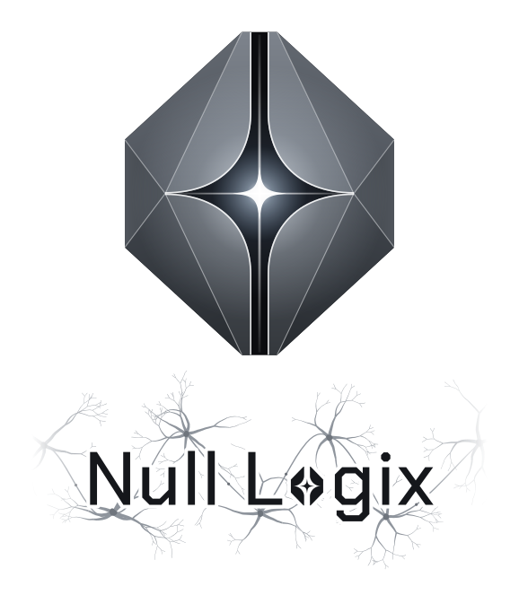

  <picture>
    <source media="(prefers-color-scheme: dark)" srcset="https://raw.githubusercontent.com/Null-Logix/.github/main/profile/assets/nulllogix-dark.svg">
    <source media="(prefers-color-scheme: light)" srcset="https://raw.githubusercontent.com/Null-Logix/.github/main/profile/assets/nulllogix-light.svg">
    
  </picture>

<h1 align="center">Welcome to the workshop. 🛠️</h1>

<strong>Curious people. Strange ideas. Useful software.</strong>

Null Logix is a place to build things we wish existed: agents that remember, tools that adapt to how we work, and software that makes a real problem less annoying.

Some ideas start with a careful design. Others start with “okay, hear me out.” Both are welcome here. Bring the thing you keep thinking about, the bug that bothers you, or the question you haven't figured out how to ask yet.

## A few doors to open

| Project | What you'll find |
| --- | --- |
| **Kleos** | Memory, context, reasoning, and coordination for AI agents. A place to explore how agents carry useful knowledge from one session to the next. |
| **FrameShift** | Project-scoped agent personas, with signed packs and tools for choosing and activating them across coding agents. |

Curious about working on something with us? Reach out to [Zan / Ghost-Frame](https://github.com/Ghost-Frame). Tell me what caught your attention or what you'd like to build.

## Your first little rabbit hole

1. **Find something interesting.** Once you have project access, read its README, run it locally, or follow an idea through the source.
2. **Leave a useful breadcrumb.** A clear question, a reproducible bug, a rough sketch, or a small docs fix is a good start.
3. **Talk before the big swing.** Open an issue with what you'd like to try so we can compare notes before you disappear into a rewrite.
4. **Show what happened.** For a change, explain the problem, what you tried, and how you checked it. Small pull requests are easier to explore together.

You don't need a grand plan to contribute. “I tried this and here's what happened” is plenty to start a conversation.

## Make room for good work

Be kind. Ask direct questions. Disagree with an idea and explain why. Give credit when you build on someone else's work, and leave enough context for the next person to pick it up.

Keep credentials and private data out of issues, screenshots, and commits. Check before sharing anything from a private repository outside the org. If you're unsure, ask.

---

**Got a weird idea? Bring it. Let's see what it does.**
